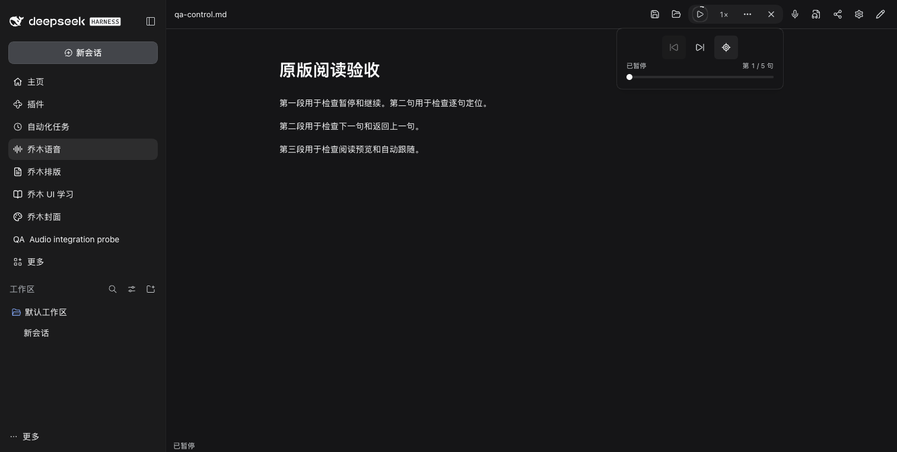

# Qiaomu Audio for DeepSeek Harness

[中文](README.md) · [Adaptation evidence](docs/ADAPTATION.md)

The original Qiaomu Audio reading controls, voice picker, settings, dictation and sharing dialogs, with the original product CSS. Harness supplies the native panel, host services, Markdown files and secure credentials.



Read Markdown from the beginning, selection, caret or visible position; pause/resume, seek sentences, adjust speed and follow reading. Providers include system/macOS voices, Edge, Kokoro/Melo, OpenAI-compatible, Qwen, Doubao, MiniMax, SiliconFlow, ElevenLabs and Azure. Dictation supports live/batch capture, retries, cancellation, recordings, cursor insertion, SenseVoice and the original cloud recognition protocols.

Export MP3 or landscape/portrait MP4 with the original four visual styles, subtitles, SRT, cover/outro, author identity and attachments. The shared `qiaomuAudio` Cordis service supports speech and transcription from other panels, while editor operations open the Audio panel. Reader/RSS settings import appears when a source registers its integration.

## Install

Requires Harness **>=0.2.1-rc.3 <0.3.0**. Download the tgz from [Releases](https://github.com/joeseesun/qiaomu-audio-dsh/releases), install and enable it through Harness plugin management, then open Qiaomu Audio in the sidebar.

```sh
dsh plugin --profile YOUR_PROFILE add /absolute/path/qiaomu-audio-dsh-0.1.2.tgz
```

Notes default to `DSH_HOME/qiaomu/qiaomu-audio-dsh/notes`, with settings/drafts in the adjacent `state.json`; `DSH_HOME` defaults to `~/.dsh`. Optional absolute `notesDir` and `dataDir` plugin configuration values are supported. Original Obsidian data is preserved.

Credentials use macOS Keychain, Windows DPAPI or Linux Secret Service (`secret-tool` required). They are excluded from settings JSON; explicit import never overwrites existing destination keys. See [local runtime setup](docs/local-runtime.md) for the optional pinned Python/Sherpa environment.

## Validation and development

macOS runtime checks exercised native voices, Edge, Kokoro/Melo, SenseVoice, MP3 and H.264/AAC MP4 output, preview, persistence, cross-plugin APIs and narrow layout. Automated tests cover the original provider protocols, retry/cancellation, native component mounting, dictation insertion and host boundaries. Paid cloud accounts use protocol fixtures; physical microphone permission and Windows/Linux runtime behavior still require their respective environments.

```sh
npm ci
npm run check
npm pack
```

Optional Cordis client service: `qiaomuAudio` (`speak`, `stop`, `transcribe`, `readNote`, `startDictation`). Reusable original components and public types: `qiaomu-audio-dsh/shared`.

GPL-3.0-only, adapted from [qiaomu-audio](https://github.com/joeseesun/qiaomu-audio). See [third-party notices](THIRD_PARTY_NOTICES.md).

`createSpeechBridge()` provides independent native synthesis, voice catalogs and local models for Reader/RSS. `coordinateSpeech()` coordinates playback ownership. Dispose both handles when the consumer unloads.

`exportSpeechSettings()` discovers the Audio TTS configuration without reading credentials. Only an explicit import action requests `exportSpeechSettings({includeSecrets:true})`; consumers copy keys to their OS credential store, never JSON settings.
